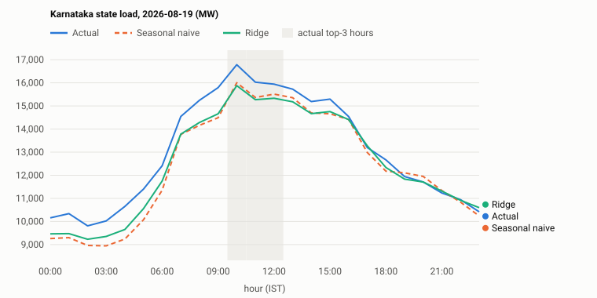

# Held-out forecast evaluation

Chronological backtest on the 14 most recent usable days (never seen in training or model selection). historical timestamp-split backtest (publication lag unvalidated).

| Model | Mean absolute error (MW) | Top-3 peak hours matched (of 3, mean) |
|---|---|---|
| Seasonal naive (same hour last week) | 580.9 | 2.71 |
| Ridge regression (lags 48/168/336 h + calendar, alpha 100.0) | 540.0 | 2.79 |

Ridge wins MAE on 8 of 14 days; seasonal naive wins on 6. Fourteen days is a small test set; this does not establish general superiority.

## Per day

| Day (IST) | Naive MAE | Ridge MAE | Naive peak hours matched | Ridge peak hours matched |
|---|---|---|---|---|
| 2026-08-04 | 348 | 628 | 3/3 | 3/3 |
| 2026-08-06 | 339 | 378 | 3/3 | 3/3 |
| 2026-08-07 | 509 | 338 | 3/3 | 2/3 |
| 2026-08-08 | 601 | 527 | 3/3 | 3/3 |
| 2026-08-09 | 733 | 355 | 3/3 | 3/3 |
| 2026-08-10 | 587 | 466 | 2/3 | 3/3 |
| 2026-08-11 | 457 | 584 | 3/3 | 3/3 |
| 2026-08-13 | 316 | 289 | 3/3 | 3/3 |
| 2026-08-14 | 633 | 207 | 2/3 | 3/3 |
| 2026-08-15 | 563 | 858 | 2/3 | 2/3 |
| 2026-08-16 | 689 | 205 | 3/3 | 3/3 |
| 2026-08-17 | 825 | 1258 | 2/3 | 2/3 |
| 2026-08-18 | 874 | 925 | 3/3 | 3/3 |
| 2026-08-19 | 659 | 542 | 3/3 | 3/3 |

## Demo day: 2026-08-19 (final test day, chosen by a predeclared rule)

| Hour (IST) | Actual MW | Seasonal naive MW | Ridge MW | Actual top-3 |
|---|---|---|---|---|
| 00:00 | 10158 | 9263 | 9464 |  |
| 01:00 | 10341 | 9304 | 9476 |  |
| 02:00 | 9813 | 8962 | 9232 |  |
| 03:00 | 10026 | 8946 | 9354 |  |
| 04:00 | 10653 | 9240 | 9654 |  |
| 05:00 | 11405 | 10075 | 10559 |  |
| 06:00 | 12409 | 11351 | 11749 |  |
| 07:00 | 14546 | 13769 | 13780 |  |
| 08:00 | 15243 | 14163 | 14285 |  |
| 09:00 | 15795 | 14491 | 14659 |  |
| 10:00 | 16785 | 16005 | 15878 | yes |
| 11:00 | 16029 | 15366 | 15271 | yes |
| 12:00 | 15944 | 15514 | 15331 | yes |
| 13:00 | 15727 | 15356 | 15180 |  |
| 14:00 | 15191 | 14698 | 14668 |  |
| 15:00 | 15296 | 14661 | 14754 |  |
| 16:00 | 14543 | 14414 | 14410 |  |
| 17:00 | 13199 | 12984 | 13273 |  |
| 18:00 | 12667 | 12177 | 12337 |  |
| 19:00 | 11945 | 12104 | 11835 |  |
| 20:00 | 11708 | 11949 | 11709 |  |
| 21:00 | 11234 | 11340 | 11313 |  |
| 22:00 | 10943 | 10836 | 10915 |  |
| 23:00 | 10421 | 10238 | 10600 |  |

Karnataka state load. Not BESCOM feeder, transformer or apartment demand.
